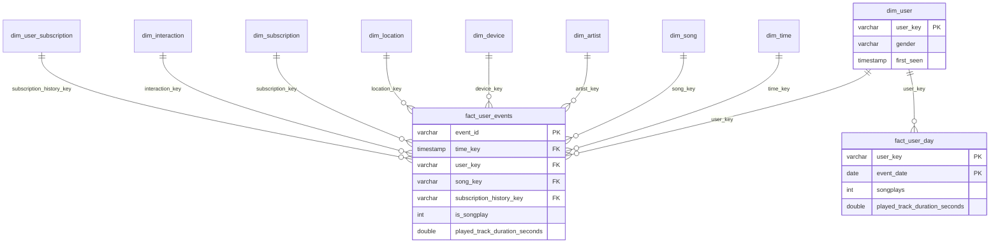

# Dimensional Model

## Grain และ Measures

| ตาราง | Grain | Measures / สถานะ |
|---|---|---|
| fact_user_events | 1 event ที่แตกต่างตาม SHA-256 ของ JSON canonical content | event_count, is_songplay, submissions, sum track duration |
| fact_user_day | 1 user ต่อ 1 calendar day ตั้งแต่ first seen ถึงวันสุดท้ายของ dataset | events, songplays, sessions, track duration รวมวันไม่มี activity เป็น 0 |
| dim_user_subscription | 1 ช่วงเวลาที่สังเกต membership ของ user | valid_from inclusive, valid_to exclusive, is_current |

รายงาน Top Songs และ KPI ใช้ event fact เดียวกัน ไม่สร้าง `fact_songplays` อีกตารางที่อาจถูก join แล้วนับซ้ำ `sessions` ต้องนับ distinct ใหม่เมื่อเปลี่ยน grain เพราะ session อาจข้ามวัน

## Star Schema

## Conformed Dimensions และ SCD

- `dim_user`: user ID เป็น natural key และ Type 1 สำหรับ gender/latest_location ไม่เก็บชื่อและนามสกุลใน warehouse
- `dim_subscription`: free/paid/unknown เป็น conformed dimension ผูก fact ด้วย **level ที่ event ระบุ**
- `dim_user_subscription`: สร้างประวัติ Type 2 จากลำดับ `level` ที่เปลี่ยน เช่น Free → Paid → Free ได้ 3 เวอร์ชัน ไม่ใช่ 2 แถวตาม distinct level ใช้ event time ไม่ใช้เวลารัน snapshot
- `dim_song`: key = MD5(artist + ASCII unit separator + song) เพราะ logs ไม่มี song_id รายการ catalog จับคู่ชื่อเพลง+ศิลปินแบบ exact และใช้ metadata เฉพาะกรณีพบรายการเดียว ถ้าชื่อกำกวมจะไม่เลือก ID สุ่ม
- `dim_artist`: key จากชื่อที่พบจริงใน logs ศิลปินชื่อเดียวกันอาจเป็นคนละคน แต่ไม่มี authoritative ID ใน logs ให้แยก ห้ามอ้างว่า entity resolution สมบูรณ์
- `dim_device`: MD5 ของ userAgent, device/browser เป็นการจัดประเภทตาม token อย่างหยาบ
- `dim_location`: สตริง location ตาม event ไม่แยกประเทศ/พิกัดที่ไม่ได้ยืนยัน
- `dim_time`: timestamp UTC พร้อม calendar attributes และ daypart; weekend คือเสาร์/อาทิตย์ ไม่ใช่วันหยุดราชการ
- `dim_interaction`: page จริง ไม่สร้าง Skip/Like/Dislike ที่ไม่มีอยู่

Anonymous events เก็บไว้ครบใน fact แต่ผูก user/history ด้วย `unknown` และไม่รวมใน DAU/MAU ผู้ใช้ที่มี user ID ใช้ membership interval ณ event time ชื่อคีย์ `unknown` ใน fact เป็นค่าที่มีแถว dimension รองรับและมี relationships tests

## Bus Matrix

✓ = ใช้มิติโดยตรง, aggregate = รวมจาก event แล้ว, future = ยังไม่มีข้อมูล

| Business Process | Fact / Grain | Time | User | Song | Artist | Device | Location | Subscription | Interaction |
|---|---|---|---|---|---|---|---|---|---|
| User Activity Tracking | events / event | ✓ | ✓ | ✓ เฉพาะเพลง | ✓ เฉพาะเพลง | ✓ | ✓ | ✓ | ✓ |
| Music Streaming | events filtered NextSong / play event | ✓ | ✓ | ✓ | ✓ | ✓ | ✓ | ✓ | ✓ |
| Content Popularity | events filtered NextSong / play event | ✓ | ✓ | ✓ | ✓ | ✓ | ✓ | ✓ | ✓ |
| Subscription State Tracking | events + membership history / event & interval | ✓ | ✓ | — | — | ✓ | ✓ | ✓ | ✓ |
| Engagement Monitoring | user_day / user+date | วันที่ | ✓ | aggregate | aggregate | aggregate | aggregate | aggregate | aggregate |
| Churn Cancellation | future | future | future | — | — | future | future | future | future |
| Ad Impressions / revenue | future | future | future | — | — | future | future | future | future |

`fact_user_day` ไม่ได้มี FK ของ song/device/subscription เพราะมีได้หลายค่าภายใน user-day อย่านำไป join แบบ 1:many กับ fact events โดยตรงเพื่อ sum measures

## Incremental และ Late Arrival

1. Python อ่าน ZIP โดยไม่ extract และ hash JSON ที่ sort key แบบ canonical ไม่นำ path/line number มารวมใน ID เพื่อให้ replay จากไฟล์ชื่ออื่นไม่เพิ่ม event ซ้ำ
2. Append เฉพาะ keys ใหม่ใน raw ภายใน transaction พร้อม source_file:line
3. dbt rebuild dimensions และ aggregates จาก raw ทั้งหมด ส่วน event fact ใช้ `unique_key=event_id` + `delete+insert`
4. ทุก incremental run ประมวลผล staged events ทั้งหมดใหม่ เพื่อให้ late arrival ที่เปลี่ยนช่วงสมาชิก re-key facts เก่าได้ถูกต้อง นี่เป็น incremental upsert ที่เน้นความถูกต้องของ sample ไม่ใช่การลดจำนวน rows scanned
5. ตรวจ duplicate, FK, nonnegative duration, reconciliation และ temporal membership ทุก build

ข้อจำกัด: logs ไม่มี authoritative event ID จึงแยก identical legitimate events จาก duplicate ไม่ได้ และการแก้ event เก่าให้เนื้อหาเปลี่ยนจะถูกนับเป็น event ใหม่ หากต้องแก้ source ให้สร้าง raw warehouse ใหม่ที่ระบุ path ใหม่ หรือออกแบบ CDC tombstone เพิ่ม `--full-refresh` สร้างเฉพาะ dbt models ใหม่ **ไม่ลบ raw ที่โหลดไว้แล้ว**

หาก user เดียวมีหลาย membership levels ณ timestamp เดียวกัน จะ fail `assert_no_conflicting_membership` แทนการเดาลำดับ ข้อมูลช่วงแรกก่อน first observation และช่วงท้ายหลัง last observation ไม่รับประกันสถานะสมาชิกจริง
